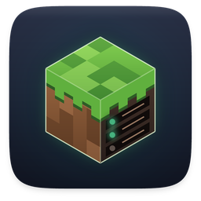

# MCSM2

**Менеджер Minecraft-серверов для macOS и Windows**

Создание, запуск, настройка, мониторинг и резервные копии серверов из одного приложения. 
Без ручной возни с Java, ядрами, консолью и папками.

**[⬇ Скачать последнюю версию](https://github.com/iamakhnach/MCSM/releases/latest)**

---

## 📖 О программе

**MCSM2** — настольное приложение для управления серверами Minecraft на вашем компьютере. Оно само подбирает и скачивает Java и ядро нужной версии, запускает сервер, показывает консоль и нагрузку, делает резервные копии и помогает пригласить других администраторов.

> [!NOTE]
> Программа в активной разработке. Основные сценарии работают, но установщик и автообновление для Windows пока проверены меньше, чем для macOS. Если что-то пошло не так, напишите (см. «Обратная связь»).

## ✨ Возможности

- **Серверы и ядра:** Vanilla, Paper, Purpur, Fabric, Forge, NeoForge, Bedrock (официальный сервер, PowerNukkitX, PocketMine-MP). Мастер создания, автоустановка Java, импорт готового сервера, клонирование, своё ядро (`.jar`, `.phar`, пакет Bedrock).
- **Консоль и игроки:** живая консоль с поиском и экспортом, чат отдельно, кик, бан, белый список, история заходов.
- **Редакторы:** параметры `server.properties` с пояснениями и проверкой значений; миры (выбор активного, переименование, выгрузка, импорт, настройки `level.dat`).
- **Плагины, моды и аддоны Bedrock:** проверка совместимости, обновления с Modrinth, пакеты `.mcpack` и `.mcaddon`.
- **Резервные копии:** полные и инкрементальные, расписание, проверка целостности, восстановление.
- **Мониторинг:** процессор, память, TPS, диск, сеть; рекомендации по памяти для каждого ядра и защита от запуска, когда её не хватает.
- **Команда:** зашифрованные приглашения администраторам, уровни доступа к каждому серверу (просмотр, запуск, управление), журнал действий, гостевой запуск с автоостановкой.
- **Веб-панель** в браузере на том же адресе, что и приложение.
- **Понятные ошибки:** при сбое установки показывается причина простыми словами, советы, подробности (выделяются и копируются) и кнопки «Повторить» и «Выбрать другую версию».
- **Обновления:** программа сама находит новые версии и ставит их (по вашему выбору, при закрытии приложения).

## ⬇ Скачать и установить

Все файлы лежат на странице **[последнего релиза](https://github.com/iamakhnach/MCSM/releases/latest)**.

| Система | Файл | Как ставить |
|---|---|---|
| **Windows 10/11 (x64)** | `MCSM2-Setup-<версия>-win-x64.exe` | Запустить установщик. Права администратора не нужны. |
| **macOS (Apple Silicon)** | `MCSM2-<версия>-osx-arm64.zip` | Распаковать и открыть `MCSM2.app` (можно перетащить в «Программы»). |

Версии для Intel Mac пока нет. Java устанавливать не нужно: программа скачает её сама.

<b>Windows просит подтверждение запуска</b>

 

Установщик пока не подписан сертификатом издателя, поэтому SmartScreen может написать «Windows защитила ваш компьютер». Нажмите **«Подробнее» → «Выполнить в любом случае»**. Целостность файла можно проверить по `SHA256SUMS.txt` из релиза: `certutil -hashfile <файл> SHA256`.

<b>macOS не даёт открыть приложение</b>

 

Приложение не подписано сертификатом разработчика. Откройте его через контекстное меню («Открыть») или один раз выполните `xattr -cr /Applications/MCSM2.app`. Проверить файл: `shasum -a 256 <файл>`.

## 🔄 Обновление

Программа проверяет релизы сама: при запуске и затем раз в несколько часов. В «Настройки → О системе → Обновления» можно проверить вручную или включить установку в фоне при закрытии приложения. Данные (серверы, миры, копии, база) при обновлении не затрагиваются.

Версии до 1.0.1 обновлять себя не умеют: один раз поставьте актуальный установщик вручную, всё остальное сохранится.

## 🔒 Данные и безопасность

- Серверы, миры, копии и база лежат вне программы: `%LOCALAPPDATA%\MCSM2` (Windows) и `~/Library/Application Support/MCSM2` (macOS).
- Ключ подписи токенов, закрытый ключ сертификата и токены входа хранятся зашифрованными (Windows DPAPI, macOS Keychain).
- Файлы обновлений скачиваются только с GitHub и проверяются по SHA-256.
- Логи и отчёты об ошибках **никуда не отправляются сами**: отчёт собирается в файл на вашем компьютере, а отправить его или нет, решаете вы.

## 🐞 Обратная связь

Нашли ошибку или есть идея? Напишите на **mcsm.manager@gmail.com**.

В программе есть панель «Настройки → О системе → Сообщить об ошибке»: она собирает описание и логи (токены, пароли и почта из них убираются) в один файл и открывает письмо, к которому остаётся приложить этот файл. Это сильно ускоряет разбор.

## 📄 Лицензия

Лицензия пока не выбрана: до её появления исходный код и сборки не стоит копировать и распространять без разрешения автора.
